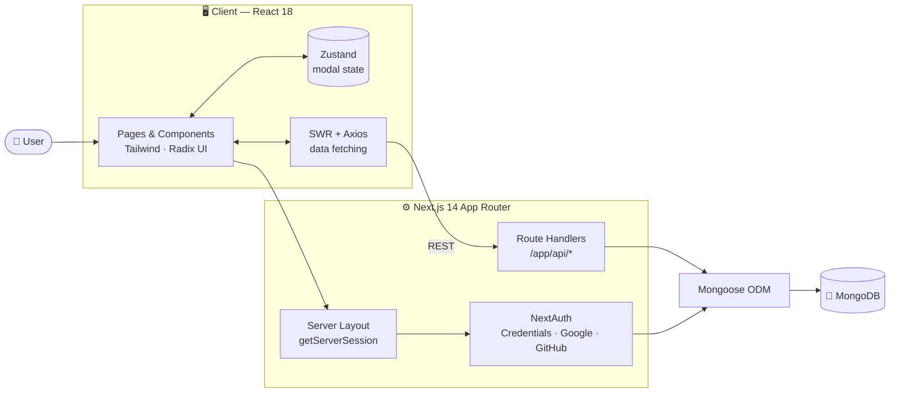
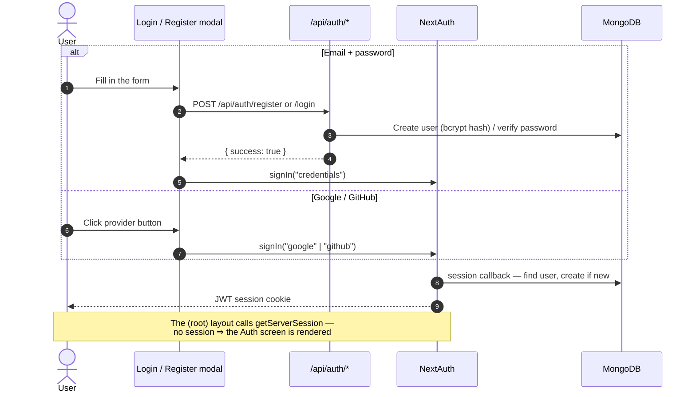
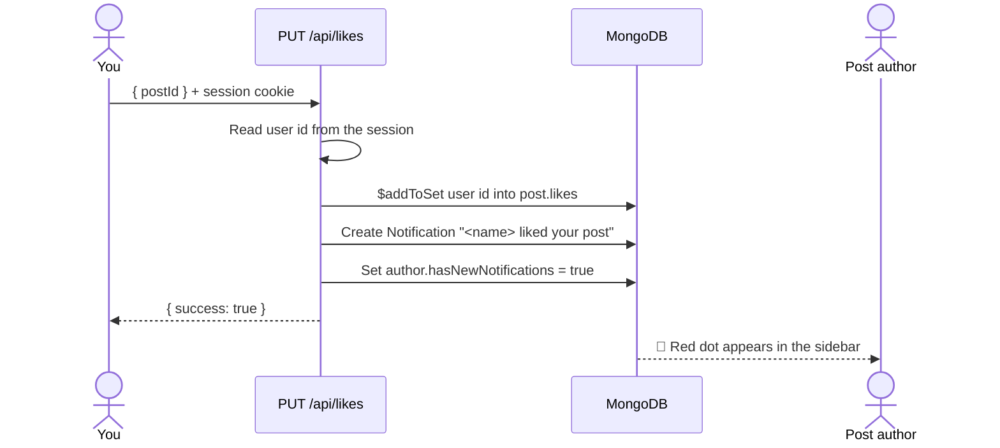
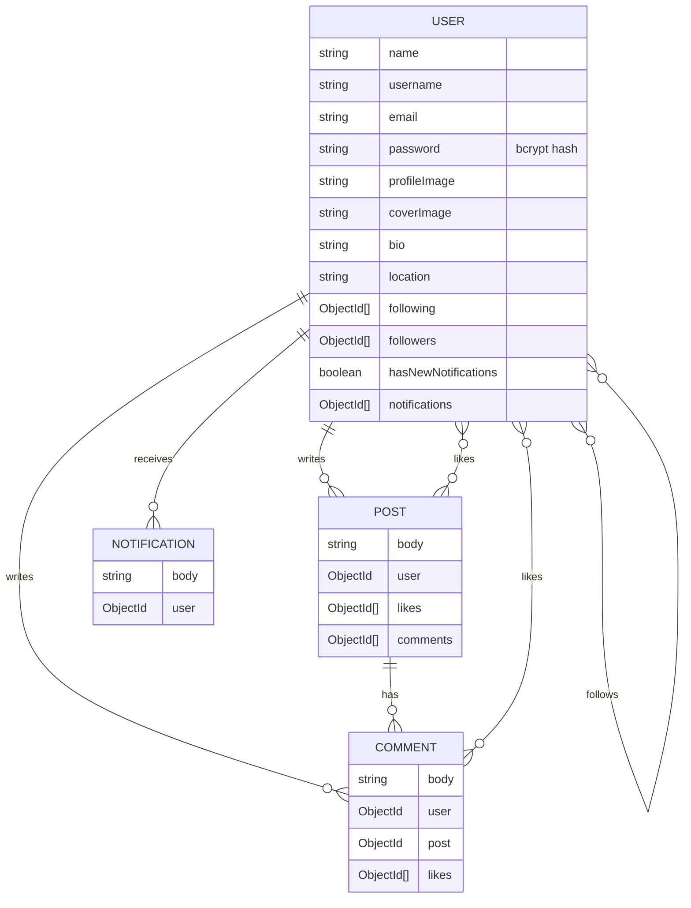

<div align="center">


# MERN Twitter

**A full-stack X / Twitter-style social network built with Next.js 14, MongoDB and NextAuth.**

Post, like, comment, follow people and get notified — all in a dark, responsive UI.

[](https://nextjs.org)
[](https://react.dev)
[](https://www.typescriptlang.org)
[](https://mongoosejs.com)
[](https://tailwindcss.com)
[](https://next-auth.js.org)
[](https://vercel.com)

[✨ Features](#-features) •
[🚀 Quick start](#-quick-start) •
[🧱 Architecture](#-architecture) •
[📡 API](#-api-reference) •
[🗄️ Data model](#️-data-model) •
[📁 Structure](#-project-structure) •
[🗺️ Roadmap](#️-roadmap)

</div>

---

## ✨ Features

| | Feature | What it does |
|---|---|---|
| 🔐 | **Authentication** | Email + password (bcrypt-hashed), plus one-click **Google** and **GitHub** sign-in via NextAuth (JWT sessions) |
| 📝 | **Two-step sign-up** | Name & email first, then username & password — validated with Zod + React Hook Form |
| 🏠 | **Home feed** | Newest-first timeline of everyone's posts, with live like & comment counters |
| ❤️ | **Likes** | Like / unlike posts and comments |
| 💬 | **Comments** | Reply to posts, view a post thread, delete your own replies |
| 👥 | **Follow system** | Follow / unfollow users, "Who to follow" sidebar, follower & following lists |
| 🔔 | **Notifications** | Get notified when someone likes, comments or follows — with an unread dot in the sidebar |
| 👤 | **Profiles** | Cover image, avatar, bio, location, join date — editable through a modal with drag-and-drop image upload |
| 🔍 | **Explore** | Search users by name or username |
| ⚡ | **Snappy UX** | SWR data fetching, top progress bar, toasts, Radix UI primitives |

> [!TIP]
> Click any **▶ section** below to expand it — this README is designed to be explored, not scrolled.

---

## 🚀 Quick start

### Prerequisites

- [ ] **Node.js 18.17+** (required by Next.js 14)
- [ ] A **MongoDB** database — local or a free [MongoDB Atlas](https://www.mongodb.com/atlas) cluster
- [ ] *(optional)* A **Google** OAuth app and/or **GitHub** OAuth app for social login

### 1 · Clone & install

```bash
git clone https://github.com/<your-username>/mern-twitter.git
cd mern-twitter
npm install
```

### 2 · Configure environment variables

Create a `.env` file in the project root:

```env
# Database
MONGO_URI=mongodb+srv://<user>:<password>@<cluster>/<db-name>

# NextAuth
NEXTAUTH_URL=http://localhost:3000
NEXTAUTH_SECRET=<random-string>
NEXTAUTH_JWT_SECRET=<random-string>

# OAuth providers
GOOGLE_CLIENT_ID=
GOOGLE_CLIENT_SECRET=
GITHUB_CLIENT_ID=
GITHUB_CLIENT_SECRET=
```

<details>
<summary><b>🔑 How do I get each of these values?</b></summary>

<br/>

| Variable | Where to get it |
|---|---|
| `MONGO_URI` | MongoDB Atlas → *Database* → **Connect** → *Drivers* → copy the connection string |
| `NEXTAUTH_URL` | The URL your app runs on — `http://localhost:3000` locally, your domain in production |
| `NEXTAUTH_SECRET` / `NEXTAUTH_JWT_SECRET` | Generate with `openssl rand -base64 32` (or `npx auth secret`) |
| `GOOGLE_CLIENT_ID` / `_SECRET` | [Google Cloud Console](https://console.cloud.google.com/apis/credentials) → *Create OAuth client ID* → redirect URI `http://localhost:3000/api/auth/callback/google` |
| `GITHUB_CLIENT_ID` / `_SECRET` | [GitHub → Settings → Developer settings → OAuth Apps](https://github.com/settings/developers) → callback URL `http://localhost:3000/api/auth/callback/github` |

</details>

> [!WARNING]
> Never commit your `.env` file — it's already listed in `.gitignore`.

### 3 · Run it

```bash
npm run dev
```

Open **[http://localhost:3000](http://localhost:3000)** and create an account. 🎉

<details>
<summary><b>📜 All available scripts</b></summary>

<br/>

| Command | Description |
|---|---|
| `npm run dev` | Start the dev server with hot reload |
| `npm run build` | Create a production build |
| `npm run start` | Serve the production build |
| `npm run lint` | Run ESLint (`next lint`) |

</details>

---

## 🧱 Architecture



<details>
<summary><b>🔐 How the authentication flow works</b></summary>

<br/>



</details>

<details>
<summary><b>❤️ What happens when you like a post</b></summary>

<br/>



The same pattern is used for **comments** and **follows**.

</details>

---

## 📡 API reference

All endpoints live under `/api` and return JSON.

> [!IMPORTANT]
> 🔒 = requires a logged-in session. These routes take the acting user from the **NextAuth session** (never from the request body), return `401` when you're not signed in and `403` when you try to change something that isn't yours.

<details>
<summary><b>🔐 Auth</b> — <code>/api/auth</code></summary>

<br/>

| Method | Endpoint | Body | Description |
|---|---|---|---|
| `POST` | `/api/auth/register?step=1` | `{ email }` | Step 1 — check the email isn't taken |
| `POST` | `/api/auth/register?step=2` | `{ name, email, username, password }` | Step 2 — create the account |
| `POST` | `/api/auth/login` | `{ email, password }` | Verify credentials |
| `GET` `POST` | `/api/auth/[...nextauth]` | — | NextAuth handlers (sign-in, callbacks, session) |

</details>

<details>
<summary><b>📝 Posts</b> — <code>/api/posts</code></summary>

<br/>

| Method | Endpoint | Body / Query | Description |
|---|---|---|---|
| `GET` | `/api/posts?limit=10` | `limit` | Latest posts with like/comment counts and `hasLiked` |
| `POST` | `/api/posts` | `{ body }` | 🔒 Create a post as the logged-in user |
| `DELETE` | `/api/posts` | `{ postId }` | 🔒 Delete your own post (and its comments) |
| `GET` | `/api/posts/:postId` | — | A single post |
| `GET` | `/api/posts/:postId/comments` | — | Comments of a post |

</details>

<details>
<summary><b>💬 Comments</b> — <code>/api/comments</code></summary>

<br/>

| Method | Endpoint | Body | Description |
|---|---|---|---|
| `POST` | `/api/comments` | `{ body, postId }` | 🔒 Add a comment (notifies the author) |
| `PUT` | `/api/comments` | `{ commentId }` | 🔒 Like a comment (notifies the author) |
| `DELETE` | `/api/comments` | `{ commentId }` | 🔒 Unlike a comment |
| `DELETE` | `/api/comments/:commentId` | — | 🔒 Delete your own comment |

</details>

<details>
<summary><b>❤️ Likes</b> — <code>/api/likes</code></summary>

<br/>

| Method | Endpoint | Body | Description |
|---|---|---|---|
| `PUT` | `/api/likes` | `{ postId }` | 🔒 Like a post (notifies the author) |
| `DELETE` | `/api/likes` | `{ postId }` | 🔒 Unlike a post |

</details>

<details>
<summary><b>👥 Users & follows</b> — <code>/api/users</code>, <code>/api/follows</code></summary>

<br/>

| Method | Endpoint | Description |
|---|---|---|
| `GET` | `/api/users?limit=5` | Suggested users ("Who to follow") |
| `PUT` | `/api/users/:userId?type=…` | 🔒 Update **your own** profile fields or profile / cover image |
| `GET` | `/api/users/posts/:userId?limit=10` | Posts written by a user |
| `GET` | `/api/users/search/:query` | Search users by name / username |
| `PUT` | `/api/follows` | 🔒 Follow a user — body `{ userId }` (notifies them) |
| `DELETE` | `/api/follows` | 🔒 Unfollow a user — body `{ userId }` |
| `GET` | `/api/follows?userId=…&state=…` | Followers / following list |

</details>

<details>
<summary><b>🔔 Notifications</b> — <code>/api/notifications</code></summary>

<br/>

| Method | Endpoint | Description |
|---|---|---|
| `GET` | `/api/notifications/:userId` | 🔒 List **your** notifications and mark them as read |
| `DELETE` | `/api/notifications/:userId` | 🔒 Clear **your** notifications |

</details>


---

## 🗄️ Data model



All models have `createdAt` / `updatedAt` timestamps. Schemas live in [`database/`](database/).

---

## 📁 Project structure

<details open>
<summary><b>Click to collapse / expand the tree</b></summary>

```text
mern-twitter/
├── app/
│   ├── (root)/                    # Authenticated area (shared layout + sidebar)
│   │   ├── (home)/page.tsx        #   🏠 Home feed
│   │   ├── explore/               #   🔍 User search
│   │   ├── notifications/[userId] #   🔔 Notifications
│   │   ├── posts/[postId]/        #   📝 Post detail + comments
│   │   ├── profile/[userId]/      #   👤 User profile
│   │   └── layout.tsx             #   Session gate → Auth screen or app shell
│   ├── api/                       # REST route handlers (see API reference)
│   ├── layout.tsx                 # Root layout, fonts, theme provider
│   └── provider.tsx               # Session & theme providers
├── components/
│   ├── auth/                      # Landing / sign-in screen
│   ├── modals/                    # Login, register, edit-profile modals
│   ├── profile/                   # Profile hero & bio
│   ├── shared/                    # Post feed, post item, comments, follow bar, uploads…
│   ├── sidebar/                   # Navigation sidebar & account menu
│   └── ui/                        # shadcn/ui primitives (Radix-based)
├── database/                      # Mongoose models: User, Post, Comment, Notification
├── hooks/                         # Zustand modal stores, SWR hooks, toast hook
├── lib/
│   ├── auth-options.ts            # NextAuth configuration
│   ├── mongoose.ts                # Cached DB connection
│   ├── validation.ts              # Zod schemas
│   └── fetcher.ts / utils.ts      # Helpers
├── public/images/                 # Logos & placeholders
└── types/                         # Shared TypeScript types
```

</details>

---

## 🛠️ Tech stack

<details>
<summary><b>See every library and why it's used</b></summary>

<br/>

| Layer | Tech | Why |
|---|---|---|
| Framework | **Next.js 14** (App Router) | Pages, layouts, and API routes in one project |
| Language | **TypeScript 5** | Type safety across client & server |
| Database | **MongoDB** + **Mongoose 8** | Flexible documents, easy relations via `ref` |
| Auth | **NextAuth 4** + **bcrypt** | Credentials + OAuth, JWT sessions, hashed passwords |
| Styling | **Tailwind CSS**, `tailwindcss-animate`, `next-themes` | Utility-first, dark theme |
| UI primitives | **Radix UI** / shadcn/ui, `lucide-react`, `react-icons` | Accessible dialogs, popovers, toasts, icons |
| Forms | **React Hook Form** + **Zod** | Declarative validation |
| Data fetching | **SWR** + **Axios** | Caching & revalidation |
| Client state | **Zustand** | Lightweight modal state |
| Uploads | **react-dropzone** | Drag-and-drop avatar & cover images |
| Misc | `date-fns`, `lodash`, `nextjs-toploader` | Dates, utilities, page-load progress bar |

</details>

---

## ☁️ Deployment

[](https://vercel.com/new)

1. Push the repository to GitHub.
2. Import it in **Vercel**.
3. Add every variable from the [`.env` section](#2--configure-environment-variables) in *Project → Settings → Environment Variables*.
4. Set `NEXTAUTH_URL` to your production URL and add the production callback URLs to your Google & GitHub OAuth apps.
5. Deploy 🚀

---

## 🗺️ Roadmap

- [x] Email / password authentication
- [x] Google & GitHub OAuth
- [x] Posts, likes and comments
- [x] Follow / unfollow
- [x] Notifications with unread indicator
- [x] Editable profiles with image upload
- [x] User search
- [ ] Image attachments in posts
- [ ] Infinite scroll / pagination
- [ ] Retweets & bookmarks
- [ ] Real-time updates (WebSockets)
- [ ] Light theme toggle

---

## ❓ FAQ

<details>
<summary><b>I get <code>MongooseServerSelectionError</code> on start</b></summary>

<br/>

Your `MONGO_URI` is wrong or your IP isn't allowed. In MongoDB Atlas go to **Network Access** and add your current IP (or `0.0.0.0/0` for testing).

</details>

<details>
<summary><b>Google / GitHub login redirects with an error</b></summary>

<br/>

The callback URL in your OAuth app must exactly match
`<NEXTAUTH_URL>/api/auth/callback/google` (or `/github`).

</details>

<details>
<summary><b><code>[next-auth][error][NO_SECRET]</code></b></summary>

<br/>

`NEXTAUTH_SECRET` is missing. Generate one with `openssl rand -base64 32` and add it to `.env`.

</details>

<details>
<summary><b>Profile images from other sites don't load</b></summary>

<br/>

`next.config.mjs` already allows remote images from any host. Restart the dev server after changing the config.

</details>

---

## 🤝 Contributing

1. Fork the repo
2. Create a branch: `git checkout -b feature/amazing-feature`
3. Commit: `git commit -m "Add amazing feature"`
4. Push: `git push origin feature/amazing-feature`
5. Open a Pull Request

---

<div align="center">

Built with ❤️ while learning the **MERN + Next.js** stack.

If this project helped you, please give it a ⭐

[⬆ Back to top](#mern-twitter)

</div>
